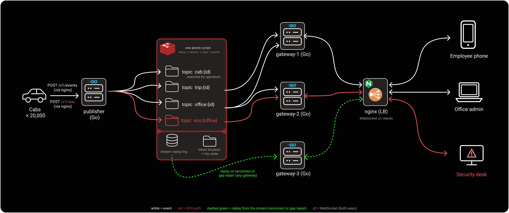

# livetrip-fanout

Live trip updates for employee transport. When a cab moves, a trip changes status or someone raises an SOS, everyone who should see it (the employee, the office admin, the security desk) gets it on their screen within milliseconds, in the right order, even if their phone drops off the network or one of our servers crashes.

Built in Go with Redis for MoveInSync Case Study 4.

- Design note (architecture, resume flow, failure table): [docs/design-note.md](docs/design-note.md)
- Demo video: [Watch Demo on YouTube](https://youtu.be/jbhRItaDSvc)



## What problem this solves

At peak, about 20,000 cabs send updates and up to 200,000 screens are watching. Sending messages is easy. These four situations are not:

1. **A phone goes into a lift for 40 seconds.** When it comes back, it should get the three updates it missed, in order, and not everything again.
2. **One security desk's browser freezes.** That must not slow down any other desk, and an SOS must still reach every desk within 2 seconds.
3. **A server crashes** while thousands of people are connected. They should move to another server without losing a single status change or SOS.
4. **One company must never see another company's trips.**

## How it works, in short

1. **A cab sends an update** to the publisher service.
2. **Redis numbers it.** Every status change and SOS on a trip gets the next number (1, 2, 3 ...) and is saved in a short history. Locations get their own version number instead. A retried update keeps its original number, so nothing is counted twice.
3. **Gateways deliver it.** Three gateway servers hold the live connections. Each one only listens for the trips its own users are watching.
4. **Every user has their own queue.** A slow user only fills their own queue. Locations are "latest only", so a slow phone never builds up a backlog of old positions. Status changes and SOS always go ahead of locations.
5. **Reconnecting users catch up.** A phone remembers the last number it saw. When it reconnects, to any server, it asks for "everything after 18" and gets exactly what it missed.

Every subscription is checked against the user's company and role, not just their login.

## Run it

You need Docker. One command starts everything (Redis, the publisher, three gateways, a load balancer and Prometheus):

```bash
make up     
```

Then open:

| | |
|---|---|
| Live demo | http://localhost:8080/demo |
| API reference | http://localhost:8080/docs |
| Metrics | http://localhost:9090 |

The demo page shows three real users side by side: a security desk, an employee and an office admin. Use the buttons to publish a status, a location or an SOS, to put the employee's phone "in a lift" for 40 seconds, or to try reading another company's trip. To see a crash, run this while the page is open:

```bash
docker compose -f deploy/docker-compose.yml kill gateway-2
```

The user on that server reconnects to another one and nothing is missed.

Stop everything with `make down`. The HTTP API is also in `postman/` and `api/openapi.yaml`.

## Benchmark

10,000 connected users, 2,000 cabs sending updates for 60 seconds, and one of the three gateways killed halfway through:

```bash
make loadtest ARGS="-kill gateway-2 -out results/run.json"
```

Machine: laptop, WSL2 on Windows, 8 CPUs, about 10 GB RAM. Everything (Docker, all services and the load generator) ran on the same machine.

| Measure | Result |
|---|---|
| Updates published | about 2,330 per second |
| Messages delivered | 693,357 (about 11,560 per second) |
| SOS: sent to shown on a desk | median 2.3 ms, 99% within 16.6 ms, none over 2 s |
| Status change: end to end | median 3.7 ms, 99% within 83 ms |
| Users moved after the gateway was killed | 3,333, back online in 0.9 s median, 1.55 s worst |
| Status or SOS deliveries missed | **0 of 109,190** (22,029 published, each sent to every user watching it) |

The slowest SOS (1.1 s) went to a desk that was on the killed gateway. It still arrived within the 2 second limit. The load test fails on its own if any user misses an update or SOS goes over 2 seconds.

## Assumptions

- Each cab gives every update its own id and reuses that id when it retries.
- Each app remembers the last update number it saw for each trip.
- Trip ownership (who rides which trip) comes from a trip service. Here it is a small built-in list for the demo.
- Secure connections (TLS) are handled by the load balancer in front.
- Demo login tokens are issued by a test endpoint. A real deployment would use the company's identity provider.

## Trade-offs

- **Correct order over always accepting.** All updates are numbered in one place (Redis). If Redis is down, new updates are refused with "try again" instead of being accepted out of order. Cabs retry safely.
- **A slow user is disconnected rather than silently missing an update.** They reconnect and catch up. Everyone else stays fast.
- **Locations keep only the newest position.** A slow phone sees fewer positions, never old ones. Status changes and SOS are never dropped.
- **Fast delivery with a safety net.** Redis Pub/Sub is fast but can lose a message. Every status and SOS is also saved in a history, and the gateways fill any gap from it.
- **Login checks are cached for 30 seconds** so that a crash, where thousands of users reconnect at once, does not overload the trip service. A reassigned trip can stay visible to the previous rider for up to 30 seconds.

**Left out on purpose:** a backup for Redis (it is a single point of failure here), authentication for cabs on the publish API, cleaning up history for finished trips, and re-sending an SOS that nobody acknowledged.

## Tests

```bash
make test         # 127 tests, run with Go's race detector
make test-redis   # the same storage tests against a real Redis (run `make redis` first)
```

Every rule in the case study has an automated test. For example: an SOS jumps ahead of queued locations, a frozen user does not slow others, a phone back from a lift gets exactly what it missed, a lost message is repaired, and a user from another company is refused. The load test above is the end-to-end proof, including the server crash.

## Built with

Go 1.27, Redis 7 (Lua script, Streams, Pub/Sub), gorilla/websocket, nginx, Prometheus, Docker Compose.
