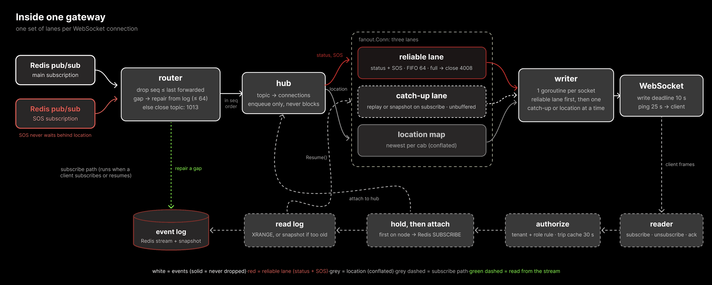
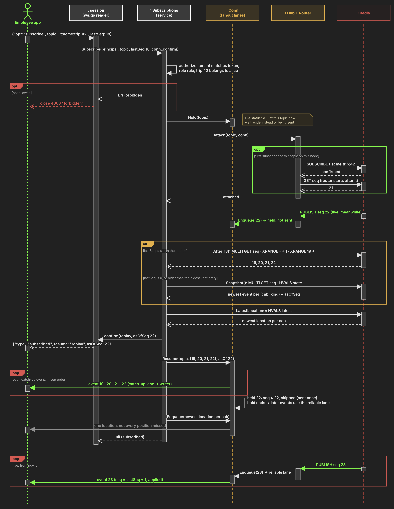

# Design note

## 1. Architecture

- **Publisher (Go).** HTTP API for cabs. `POST /v1/events` for location and status, limited to 256 requests in flight (then `503` with `Retry-After`). `POST /v1/sos` has its own Redis connection pool, no limit and one retry, so a flood of locations never holds an SOS back.
- **Redis.** One Lua script (`scripts/publish.lua`) handles each event atomically: dedup by `eventId` (10 minutes per topic), take the next number from the topic's counter (`seq` for status and SOS, a separate `ver` for location), store it (status and SOS in a stream that is the replay log, about 1,000 kept per topic; location as "latest per cab"), then `PUBLISH` on the topic's channel. All keys of a topic share a `{topic}` hash tag, so the script also works on Redis Cluster.
- **Gateways (Go, three nodes behind nginx).** Hold the WebSocket connections. A gateway subscribes to a topic's channel only while one of its clients watches it. They keep no state that matters, so any gateway can serve any client.
- **nginx.** One entry point on port 8080, `least_conn` across gateways with state shared between its workers, no sticky sessions.

**Who assigns the sequence number:** Redis, inside the Lua script, one counter per topic. Not clients and not gateways, because clocks differ and a gateway's counter would die with it. Location has its own counter, so dropping old positions never looks like a gap in `seq`.

## 2. Inside a gateway

- **Two Redis subscriptions.** SOS topics use their own connection, so they never queue behind location traffic.
- **Router.** Remembers the last `seq` forwarded per topic. Duplicates are dropped. A gap (lost Pub/Sub message, Redis reconnect) is filled from the stream, up to 64 events. A longer gap closes that topic's clients with `1013`, and they resume.
- **Hub.** Topic to connections on this node. It only enqueues and never writes to a socket, so a frozen client cannot slow anyone else.
- **Three lanes per connection.** Reliable lane for status and SOS (FIFO, 64 slots; when full the client is closed with `4008` and resumes, nothing is dropped). Location map with only the newest position per (topic, cab). Catch-up lane used only while resuming, so a long replay never fills the reliable lane.
- **One writer goroutine per connection** writes to the socket and always takes the reliable lane first.

## 3. Resume after a disconnect (the hardest flow)

The client sends `{"op":"subscribe","topic":"t:acme:trip:42","lastSeq":18}`.

1. **Authorize.** The tenant comes from the token and must match the topic. Then the role rule applies. "No such trip" and "not your trip" give the same answer.
2. **Hold, then attach.** Live status and SOS for this topic are held aside on the connection before it joins the hub, so nothing published from now on can be lost or overtake the replay.
3. **Read the catch-up.** `XRANGE` after 18 returns 19, 20, 21, 22 (22 was published meanwhile, so it is also waiting in the hold). If `lastSeq` is 0, or older than the oldest kept entry, the client gets a snapshot instead: the newest event per (cab, kind) and the `seq` it is valid at.
4. **Confirm.** `{"type":"subscribed","resume":"replay","asOfSeq":22}` is sent before any event of the topic.
5. **Send in order.** The missed events through the catch-up lane, then held live events not already sent (the held 22 is skipped, so it arrives once), then the newest location per cab.

## 4. Failure modes

| What fails | What the user sees | How the system recovers |
|---|---|---|
| A gateway crashes | Disconnect, back within about a second | nginx sends the client to a healthy gateway; it resumes from `lastSeq` out of Redis |
| A phone loses network | Map pauses, then catches up | Replay of exactly what was missed, or a snapshot if away too long |
| A client is too slow | Only that client: positions skip ahead, then a reconnect | Location is conflated; a full reliable lane closes it with `4008`; it resumes |
| A Pub/Sub message is lost or a gateway's Redis connection drops | Nothing, or a short delay | Router sees the `seq` gap and reads it from the stream; if it cannot, clients get `1013` and resume |
| A cab retries a publish | Nothing | Same `eventId` returns the original `seq`; nothing is stored or sent twice |
| Location flood at the publisher | Cabs get `503` + `Retry-After` for location and status | SOS uses its own path and is not limited |
| Redis briefly unreachable | `503` on publish | Cab retries with the same `eventId`; SOS is retried once within 1 s |
| Redis down for longer | Publishing fails; new subscribes get `1013`; open sockets stay idle | After restart, AOF keeps counters and streams, so `seq` continues without reuse. Redis is the single point of failure in this build |
| A gateway is full (50,000 connections) | `1013` try again later | Client reconnects, normally to another node |
| Someone subscribes to another company's topic | Closed with `4003` | Refused before anything is attached or read |

## 5. Limits and capacity

| Limit | Value | When reached |
|---|---|---|
| Reliable lane per connection | 64 events | Close `4008`, client resumes |
| Replay log per topic | about 1,000 events | Snapshot instead of replay |
| Gap a gateway repairs itself | 64 events | Topic's clients get `1013` and resume |
| Connections per gateway | 50,000 | New connections get `1013` |
| Publisher requests in flight | 256 | `503` for location and status; SOS not counted |

Measured with 2,000 real connections (`make bench`): **54 KB per connection**, of which
about 18 KB is goroutine stacks (HTTP server, reader, pinger), 11 KB is the reliable lane
(64 events allocated up front) and the rest is WebSocket and HTTP state. The clients ran in
the same process, so this is an upper bound for the server's share. The ceiling is the single Redis primary, because every publish runs one Lua script there. The next step is Redis Cluster; the `{topic}` hash tags already allow that without code changes.

## 6. WebSocket protocol

Token in `Authorization: Bearer ...` or `?token=`.

| Direction | Message |
|---|---|
| client | `{"op":"subscribe","topic":"t:acme:trip:42","lastSeq":17}`, `unsubscribe`, `ack` |
| server | `hello` (gateway name, always first), `subscribed` (replay or snapshot, before any event), `event`, `unsubscribed`, `error` |

| Close code | Meaning |
|---|---|
| 4001 | Missing or expired token |
| 4003 | Not allowed to watch that topic |
| 4008 | Too slow, reliable events piled up |
| 1013 | Try again later |
| 1011 | Internal error |
| 1001 | Gateway shutting down |

## 7. Monitoring

Every service exposes `/metrics`, scraped by Prometheus every 5 seconds. The first things to watch at 3 AM: `livetrip_delivery_latency_seconds{kind="sos"}`, `livetrip_reliable_queue_depth`, `livetrip_ws_closes_total{reason}`, `livetrip_gap_repairs_total`, `livetrip_redis_errors_total`. Labels never include topic, tenant or user. Logs are JSON; payloads are never logged, and phone, email and coordinates are redacted if they ever appear.

## 8. Cost of the core operations

| Operation | Time | Space |
|---|---|---|
| Publish (Lua script) | O(1) per event | one stream entry per status/SOS; one hash field per cab for location |
| Hub.Publish | O(subscribers of the topic on this node) | nothing extra |
| Conn.Enqueue | O(1), never blocks | reliable lane fixed at 64 events |
| Location conflation | O(1) | bounded by cabs per topic, not by update rate |
| Resume | O(missed events), at most about 1,000 | streamed to the client, not buffered |
| Gap repair | O(gap), at most 64 | |

Benchmarks (`make bench`, Intel Core Ultra 7 155H, no race detector):

| Benchmark | Result |
|---|---|
| Enqueue a status on one connection | 61 ns, 0 allocations |
| Conflate a location | 113 ns, 0 allocations |
| Hub fan-out of one status to 100 / 10,000 subscribers | 4.7 µs / 2.2 ms (47–216 ns per delivery), 0 allocations |
| Publish to the in-memory log | about 0.8 µs |
| Replay 1,000 events | 77 µs |
| Memory per connection | 54 KB |

**Sizing.** The local setup runs 3 gateways. That is the smallest cluster where one node
can be killed and two remain, and it carries the 10,000-connection test with room to
spare. For the case study's real peak of 200,000 screens: 200,000 × 54 KB ≈ 11 GB of
connection memory, and at 50,000 connections per gateway that needs at least 4 gateways;
production would run 5 or 6 so that losing one still leaves headroom. Adding a gateway is
one more service in the compose file (or more replicas in Kubernetes); nothing in the code
changes, because gateways keep no state. Redis remains the ceiling: every publish runs one
Lua script on a single primary, so an SOS script can wait a few microseconds behind queued
location scripts. Redis Cluster spreads topics across shards; keys are already hash-tagged
per topic.

**Known limits.** Gap repair reads Redis on the bus goroutine, so a slow repair can delay
other topics on that node by up to 2 s. A topic's first subscriber on a node waits for the
Redis SUBSCRIBE round trip, and these first-subscribes are handled one at a time.